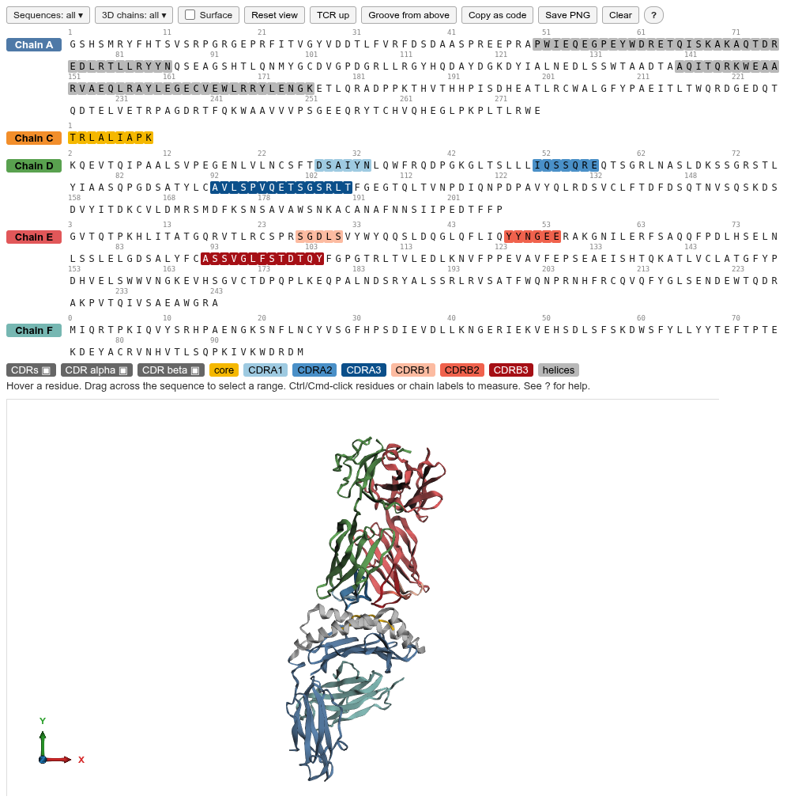
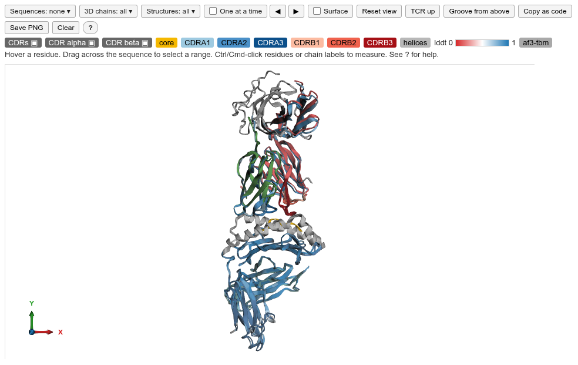

# tcrstruct

Analyze and annotate TCR-pMHC structures and sequences: which chain is which, the MHC
gene and allele, the TCR V genes, the CDRs and peptide core, an IMGT label on every
residue, and how the TCR docks. Then benchmark predicted models against experimental
structures, and build clean data sets. Use it as a Python library or from the command
line.

## What is it for?

1. **Understand a TCR-pMHC.** From a structure (PDB, mmCIF) or just its sequences
   (FASTA), find the TCR alpha / beta, MHC, B2M and peptide chains, the MHC gene and
   allele, the TCR V genes, the CDRs and the peptide core. In a structure, also the
   crossing and incident docking angles, CDR-peptide contacts and 3D views with every
   region marked.
   * **The same region in every file.** Each residue gets its IMGT label (TCR V domains
     and MHC groove domains), so `regions='cdr3'` or the MHC helices mean the same
     residues whatever the file's chain IDs and numbering.
2. **Benchmark structure predictions.** Score AlphaFold 3, Boltz, TCRmodel2 or any other
   models against their experimental structures: RMSDs of the peptide and each CDR,
   DockQ, lDDT, TM-score and docking-angle errors, for one pair or whole folders.
3. **Build clean data sets.** List TCR-pMHC entries from TCR3d or STCRDab, download them
   from the RCSB PDB, check that each is a complete complex, pick one copy from multi-copy
   files, and write them with standard chain IDs and IMGT numbering.

## What it covers

| | function | what it does |
|---|---|---|
| **analyze** | `TCRFrame.read`, `TCRFrame.from_rcsb` | a structure or FASTA with chains A-F, genes, IMGT labels and regions |
| | `s.report()`, `s.chain_table`, `s.cdrs`, `s.residues` | chains and genes, CDR sequences, one row per residue with its IMGT label and region |
| | `s.select(regions=...)`, `s.contact_map()` | region selections (CDRs, peptide core, MHC helices, ...), CDR-peptide contacts |
| | `s.angles`, `s.view()` | docking angles; 3D views with the regions and docking vectors marked |
| | `tcs.find_complexes`, `s.verify()` | each copy of the complex in a file; is it a complete complex? |
| **benchmark** | `tcs.compare`, `compare_dirs` | a model against its reference: one row of metrics, or one per model |
| | `per_residue_lddt`, `view_comparison` | which regions are off; the model on the reference, colored by lDDT |
| **data sets** | `tcs.sources` | TCR3d and STCRDab lists, RCSB metadata and batch downloads |
| | `tcs.normalize`, `s.split()`, `split_fused_peptide`, `verify_dir` | standard chain IDs and IMGT numbering, parts as files, checks per file |

Standard chain IDs: **A** MHC heavy chain (class I) or alpha chain (class II), **B** MHC
beta chain (class II), **C** peptide, **D** TCR alpha, **E** TCR beta, **F** B2M.

**Where it fits.** tcrstruct is built on [PDBFrame](https://github.com/akdslab/PDBFrame)
(a structure as a pandas table of atoms) and [tcrkit](https://github.com/akdslab/tcrkit)
(ANARCI numbering of TCR chains, MHC genes and IMGT G-domain numbering). A `TCRFrame` is a
PDBFrame, so every PDBFrame method works on it too.

## Install

```bash
pip install git+https://github.com/akdslab/tcr-struct-bench.git
```

PDBFrame and tcrkit come with it. ANARCI runs in-process (pyhmmer), so there is no
`hmmscan` binary or conda environment to set up.

## A quick tour

**What is in the file?**

```python
import tcrstruct as tcs
from tcrstruct import TCRFrame

ref = TCRFrame.from_rcsb('1AO7')        # or TCRFrame.read('1ao7.cif'), or '1ao7.fasta'
print(ref.report())
# TCRFrame '1AO7', MHC class I, chains A, C, D, E, F
#   A  MHC heavy chain A0201        274 aa   (chain A in the file)
#   C  peptide                        9 aa   (chain C in the file)
#   D  TCR alpha       TRAV12-2*01  115 aa   (chain D in the file)
#   E  TCR beta        TRBV6-5*01   209 aa   (chain E in the file)
#   F  B2M             B2M_human    100 aa   (chain B in the file)
#   peptide LLFGYPVYV
#   CDRs    CDRA1=DRGSQS  CDRA2=IYSNGD  CDRA3=AVTTDSWGKLQ  CDRB1=MNHEY  CDRB2=SVGAGI  CDRB3=ASRPGLAGGRPEQY

ref.angles      # {'crossing_angle': 33.53, 'incident_angle': 11.31}
ref.residues    # one row per residue: chain, number, IMGT label, region
ref.select(regions='cdr3')          # the CDR3 atoms, as a TCRFrame
ref.view()                          # 3D, with the peptide core, CDRs and MHC helices marked

seqs = TCRFrame.read('1ao7.fasta')  # sequences only: the same chains, genes, CDRs, IMGT labels
seqs.cdrs['CDRB3']                  # 'ASRPGLAGGRPEQY'
```



**Score a model**

```python
row = tcs.compare('af3_1ao7.cif', ref)     # a pandas Series, one value per metric
row[['Full', 'Peptide', 'CDRB3', 'Mean_CDR', 'DockQ', 'lddt', 'tm_score']]
# Full        1.492      RMSDs in Å, after a peptide-centric superposition
# Peptide     0.538
# CDRB3       2.034
# Mean_CDR    1.002
# DockQ       0.910
# lddt        0.896
# tm_score    0.990

tcs.per_residue_lddt('af3_1ao7.cif', ref, by='region')   # which regions are off, worst first
tcs.view_comparison('af3_1ao7.cif', ref)                 # model on reference, colored by lDDT
```



**A whole benchmark.** Models are paired with references by the PDB ID at the start of
the file name (`af3/7N2N_model_0.cif` goes with `7N2N.cif`):

```python
table = tcs.compare_dirs('predictions/', 'references/', n_jobs=8)   # one row per model
```

**A clean data set**

```python
cx = tcs.sources.tcr3d_complexes('II')                  # every class II TCR-pMHC in TCR3d
tcs.sources.rcsb_download(cx['pdb_id'], 'raw/', n_jobs=8)
checks = tcs.verify_dir('raw/', n_jobs=8)               # valid, failed and warned checks per file
tcs.normalize_dir('raw/', 'clean/')                     # chains A-F, TCRs numbered by IMGT
```

### Command line

```bash
tcrstruct info 1ao7.cif                                  # chains, genes, CDRs, angles
tcrstruct compare model.cif reference.cif
tcrstruct compare-dirs predictions/ references/ -o metrics.csv -j 8
tcrstruct rcsb-download --tcr3d II -o raw/
tcrstruct verify raw/ -o checks.csv
tcrstruct normalize raw/ clean/
tcrstruct --help
```

## Learn more

* [docs/tcrframe.md](docs/tcrframe.md): every attribute and method of a `TCRFrame`.
* [docs/metrics.md](docs/metrics.md): every metric, how it is computed, the seven
  superpositions, and the two versions of the fit, DockQ, TM-score and angles (defaults,
  and `'v1'` with `**tcs.V1`).
* [docs/datasets.md](docs/datasets.md): sources, downloads, checks and normalizing.
* [docs/cli.md](docs/cli.md): every command.
* The notebooks: [01_scoring](notebooks/01_scoring.ipynb),
  [02_annotation](notebooks/02_annotation.ipynb), [03_variants](notebooks/03_variants.ipynb),
  [04_sequences](notebooks/04_sequences.ipynb),
  [05_verification](notebooks/05_verification.ipynb).
* **Claude Code.** The docs and four skills (scoring, inspecting, viewing, building a
  data set) come with the package: `tcrstruct docs metrics` prints a page, and
  `tcrstruct skills install` (`--deps`: PDBFrame's and tcrkit's too) copies the skills
  into `~/.claude/skills`.

## References

| what | used by | reference |
|---|---|---|
| ANARCI (via tcrkit) | TCR IMGT numbering | Dunbar and Deane, *Bioinformatics* 32, 298-300 (2016) |
| IMGT numbering | TCR and MHC labels | [IMGT](https://www.imgt.org), Lefranc et al. (CC BY 4.0) |
| DockQ v2 | `DockQ` (default) | Mirabello and Wallner, *Bioinformatics* 40, btae586 (2024) |
| Pierce lab `tcr_docking_angle` | docking angles (default) | [piercelab/tcr_docking_angle](https://github.com/piercelab/tcr_docking_angle) (CC BY 4.0) |
| MHC Motif Atlas | `'v1'` helices | [mhcmotifatlas.org](http://mhcmotifatlas.org) |
| TCR3d | `tcs.sources.tcr3d_*` | [tcr3d.ibbr.umd.edu](https://tcr3d.ibbr.umd.edu) |
| STCRDab | `tcs.sources.stcrdab` | [STCRDab](https://opig.stats.ox.ac.uk/webapps/stcrdab-stcrpred) |
| RCSB PDB | structures | [rcsb.org](https://www.rcsb.org) |

## License

[MIT](LICENSE). The structures in `tests/data` keep their sources' terms
([tests/data/README.md](tests/data/README.md)).

## Development

```bash
git clone https://github.com/akdslab/tcr-struct-bench.git && cd tcr-struct-bench
uv sync                  # .venv with PDBFrame and tcrkit at the commits pinned in pyproject.toml
uv run pytest
```

To work on PDBFrame or tcrkit at the same time, clone them next to this repository and
install them over the pinned versions: `uv pip install -e ../PDBFrame -e ../tcrkit` (the
next `uv sync` puts the pinned versions back).
